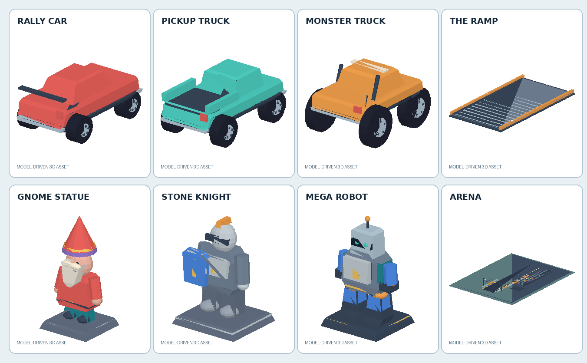

# Ramp Wreckers

A model-driven 3D arcade stunt/destruction game for Godot 4.7.2 .NET, C# and .NET 10.

Drive an authored rally car, pickup or monster truck down a runway, climb an adjustable
ramp, and smash three towering statues into their individually modelled components.
Nine authored campaign challenges and a Free Smash mode are included. No accounts,
telemetry, purchases or online features.



## Play

1. Install **Godot 4.7.2 .NET** and the **.NET 10 SDK**.
2. Open `project.godot` in the .NET editor and let Godot import the GLB/OBJ/WAV assets.
3. Build the C# project (`dotnet build` or the editor Build button).
4. Run `scenes/Main.tscn` (the configured main scene).

The game starts directly in the arena: no blocking title screen. The pickup is ready at
the start line. A small start hint and the full HUD are visible immediately.

### Controls

| Input | Action |
|---|---|
| **W/S** or Up/Down | Accelerate / reverse |
| **A/D** or Left/Right | Steer |
| **Space** | Brake |
| **R** | Instant retry (restores the statue and car) |
| **1 / 2 / 3** | Rally car / pickup / monster truck |
| **J / K** | Previous / next challenge (statue in Free Smash) |
| **Q / E** | Lower / raise the ramp (10°–27°) |
| **F** | Toggle Free Smash |
| **C** | Cycle chase / wide / hood camera. Also skips the impact close-up. |
| **Right-mouse drag** | Orbit the chase camera; wheel zooms |
| **G** or **Tab** | Garage: vehicles, unlocks, upgrades, paint, quality, volume |
| **B / V** | Quality preset / master volume |
| **P** | Cycle unlocked paint |
| **H** | Re-show the control hint |

Gamepad: left stick drives/steers, A brakes, Y retries, Start opens the garage,
X/B/LB select vehicles, D-pad changes challenge and ramp, F/Space toggles Free Smash.

## What is implemented

- **Arcade driving:** four invisible wheel collision spheres, four ground probes,
  acceleration, reverse, braking, lateral grip, steering authority, downforce,
  anti-flip alignment, airborne control, auto-recovery from upside-down landings,
  speed/ramp/statue framing and a debris-aware camera.
- **Distinct vehicles:** rally car (fast/light), pickup (balanced), monster truck
  (heavy/slow/large wheels). Engine and tyre upgrades change handling permanently.
- **Adjustable physical ramp:** authored GLB and its invisible collider rotate together.
  The collider foot is flush with the runway at 10°, 16° and 27°.
- **Structural destruction:** each statue is built from separate authored GLB parts.
  Intact parts use invisible `Area3D` hit volumes; broken parts become bounded rigid
  body debris. Support/protection links are authored per scene. One support gone leans
  the statue; both gone topples the upper body. The robot armour protects its core until
  peeled, then a direct core strike gets a weak-point bonus and short slow motion.
- **Nine challenges + Free Smash** with progress, medals, first-clear coins, replay,
  unlocks and persistent progress. Free Smash never grants campaign rewards.
- **Persistence:** versioned JSON at `user://ramp_wreckers_save.json`, atomic temp-file
  replace, validated backup recovery, honest save-failure UI. Corrupt/empty saves fall
  back safely without overwriting a good backup.
- **Presentation:** authored dust-puff and debris meshes, procedural-free debris,
  crash/launch/reward cues, looping engine sample with speed/throttle pitch, speedometer,
  objective prompt, completion banner, camera shake and slow motion.
- **Performance option:** high quality (shadows, fog, 4× MSAA) or performance quality.

## Geometry policy

All visible 3D geometry is an authored GLB asset instantiated in an editable `.tscn`.
There are no visible Godot primitive meshes, CSG meshes, `ArrayMesh`, `ImmediateMesh`
or runtime mesh generators in the shipping scenes or game code. Invisible `Shape3D`
colliders, raycasts, `Area3D` hit volumes, UI and particles are allowed.

`art/source/` contains editable OBJ authoring copies for every GLB. `mesh_sources.zip`
is the original archived source bundle. `tools/make_assets.py` recreates the authored
dust/debris GLBs and the seamless engine loop; it is an offline authoring tool, never
loaded by the game.

## Tests and verification

Quick automated suite (requires Godot on PATH or set `GODOT_BIN`):

```bash
./tools/run_all_tests.sh
```

This runs:

- `tools/validate_project.py` — resource references, no visible primitives/CSG,
  statue graph integrity, challenge part IDs, nine challenges, policy files.
- `dotnet build -c Release` — C# compilation.
- `dotnet run --project tests/UnitTests` — pure .NET catalog, impact and save tests.
- Godot headless editor import.
- 60-second headless boot.
- `tests/RuntimeTests.tscn` — save/corruption, statue graph, robot armour/core ordering,
  30 reset cycles, ramp geometry at 10/16/27°, low-speed contact, audio assets,
  input smoke, Free Smash reward isolation, 30 bounded retries, and a physics-driven
  route that drives all three vehicles over the ramp into the gnome.

Capture visual evidence with a real rendered viewport:

```bash
./tools/run_visual_evidence.sh
```

Exports:

```bash
./tools/export_game.sh
```

Linux release: `build/linux/RampWreckers.x86_64`.
Windows release: `build/windows/RampWreckers.exe` (exported; not executed on this Linux host).

## Known limitations

See `docs/VERIFICATION.md` for the current verification record and known issues,
including the intentional arcade choice to let fast vehicles pass through intact
statue hit volumes in the impact frame, and the fact that the Windows export was
not run on this host.

## Project layout

- `scenes/` — authored arena, HUD, vehicles and statues.
- `art/meshes/` — runtime GLB assets; `art/source/` — editable sources.
- `src/` — C# gameplay, destruction, persistence, input, effects.
- `tests/` — deterministic runtime and pure .NET tests.
- `tools/` — static validation, asset authoring, test/export scripts.
- `docs/` — design, art contract, acceptance checks, verification.
